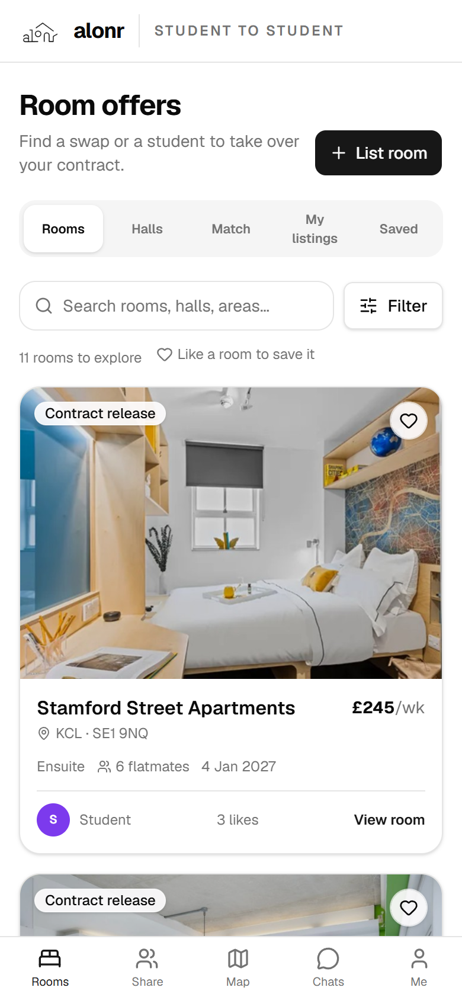
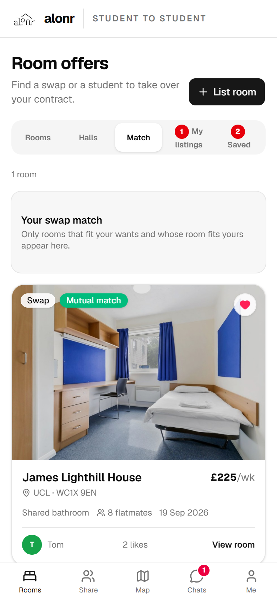
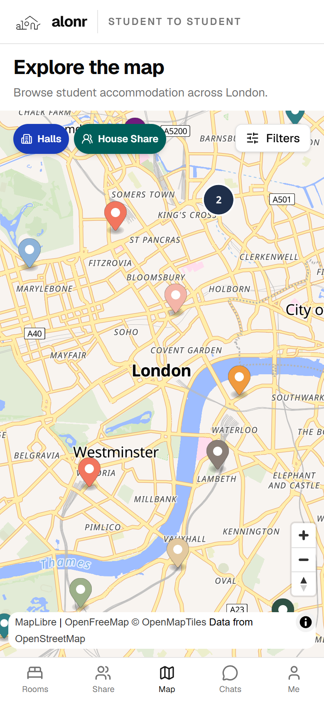
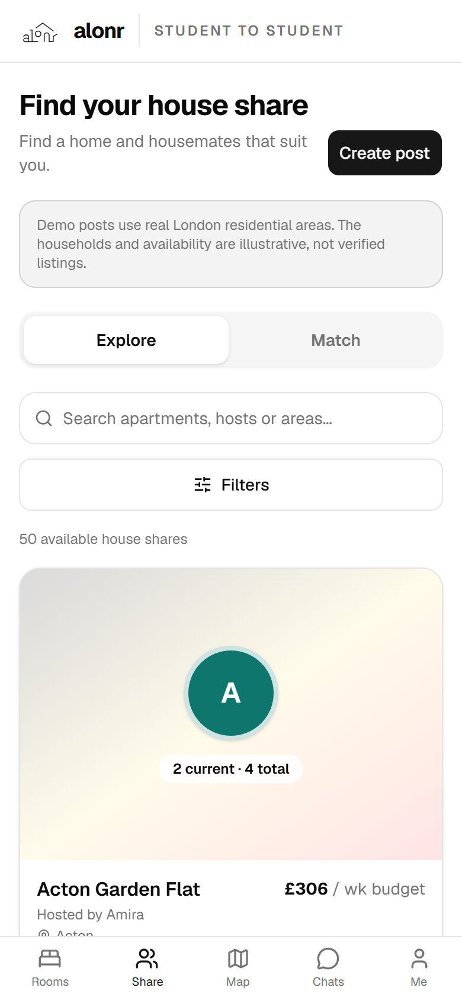

# alonr: swap your London student room

**Live app: https://alonr.vercel.app** (works on any phone or laptop; installable as an app)

London students get stuck in accommodation contracts they no longer want: the wrong campus (UCL Bloomsbury vs UCL East), the wrong price, or the wrong room type. Today they post on Facebook groups and hope. There's also no easy way to compare halls across providers (Unite, iQ, Chapter, Scape, university halls…).

**alonr** is a verified-student app that does three things:

1. **Map:** 48 real London halls from 20 providers, with prices, room types and walking distances, and filters for everything that matters to students.
2. **Room offers:** list your room as a **swap** or a **contract release**. alonr finds **mutual matches**: rooms that fit what you want *and* whose owner wants a room like yours.
3. **House Share:** for students leaving halls, match with households by budget, area, move-in date and lifestyle, with a compatibility score.

| Rooms | Mutual match | Map | House Share |
|---|---|---|---|
|  |  |  |  |

---

## Try it (judges)

1. Open **https://alonr.vercel.app** on your phone or laptop.
2. Browse without signing in: **Rooms**, **Map** and **Share** are public.
3. To like, list a room or chat, tap **Me → Sign in** and use the judge account:
   - Email: `judge@demo.ac.uk`
   - Code: the **tester code from our submission** (it isn't in this public repo). Demo accounts get no email; you type the code straight in.
4. Real students sign in with any `.ac.uk` address and get a 6-digit code by email. Other domains are rejected.

### The 1-minute demo: find a mutual swap
Signed in as `judge`:

1. **Rooms → List room** and pick **Templars House** (UEL, Docklands). Room type, price and flatmates fill in automatically.
2. Choose move-in and move-out dates.
3. Under **Halls you would consider**, tick **Floyer House** (QMUL, Mile End).
4. Under **Room types you would consider**, also tick **Shared bathroom**.
5. Add a line of description, then **Publish swap listing**.
6. Open the **Match** tab. **Omar** (at Floyer House, looking for an ensuite under £260) appears with a **Mutual match** badge. Tap **View room → Message** to chat in real time.

Other things to try:
- **Map:** filter by budget, room type, your university, walking time to a station or supermarket, or a nearby bike dock. Tap a pin to open the hall page.
- **Saved:** tap the heart on any room.
- **Share → Match:** pick a few filters and see households ranked by compatibility %.
- **Install it:** on iPhone, Safari → Share → *Add to Home Screen*. On Android, Chrome → ⋮ → *Install app*.

### What's real and what's demo data
- **Real:** the 48 halls, their prices, room types, facilities and distances (curated by us, enriched from OpenStreetMap and TfL), sign-in, likes, matching and live chat.
- **Demo:** the 12 `@demo.ac.uk` students and their 11 room listings, which tell a story of 3 mutual swap pairs plus Omar waiting for a match. The 50 House Share households are clearly labelled as illustrative. House Share posts and chats you create stay in your browser.

---

## Features

**Map and halls**
- Pins coloured by provider, clustering, and provider chips.
- Filters:
  - price and room type;
  - flatmates and contract length;
  - my university;
  - walk to a supermarket or station, nearby bike dock;
  - catered, 24/7 reception, accessible;
  - "has rooms listed".
- Use your location to find halls near you.
- A page for every hall: rooms and prices, facilities, nearest supermarket, station and Santander bike dock, plus the rooms students are offering there.

**Room offers**
- List a room as a swap or a contract release. Picking the hall auto-fills the room details. Add photos.
- Feed with grid and list views, likes, Saved and My listings (close or delete).
- **Match:** a two-way check that their room fits your wants *and* your room fits theirs, done in a Postgres function. Pass or like each match.
- One tap to a **real-time chat** (Supabase Realtime) with unread badges.

**House Share**
- Filter households by budget, area, move-in, age group, study level, gender, pets, smoking, drinking, parties, instruments, languages and facilities.
- **Compatibility %**: move-in timing and distance between areas weigh most; each other preference you pick counts equally.
- Create a post (stored locally in the demo) and chat with a household.

**Accounts and trust**
- Sign-in only with `.ac.uk` emails. A database trigger rejects other domains and matches your university from your email domain.
- Profiles show a bio, country and languages, visible only to signed-in students.
- Row-level security: anyone can browse; only you can edit your own listings and profile; only the two people in a chat can read it.

**App**
- An installable PWA: one codebase for phone and web.
- Mobile-first design, link previews when shared.

---

## How it's built

| Part | Tech |
|---|---|
| App | Next.js 16 (App Router) as a PWA, React 19, TypeScript, Tailwind CSS 4, shadcn/ui |
| Backend | Supabase: Postgres, Auth (email code), Storage (listing photos), Realtime (chat), row-level security |
| Map | MapLibre GL with OpenFreeMap tiles, turf.js for distances |
| Data | A curated CSV of halls plus Python scripts: OpenStreetMap (nearest supermarket and station) and the TfL BikePoint API (nearest bike dock) |
| Email | Gmail SMTP for sign-in codes |
| Hosting | Vercel, deployed from `main` |

**Mutual matching** is the `match_listings(listing_id)` SQL function. It returns listings where each side's `wants` (halls, room types, max price) is met by the other side's room.

### Repo map
```
app/            pages: listings (Rooms), map, property/[id] (hall page), houseshare, messages (chat), profile (Me), login
components/     UI: map, filters, listings, chat, profile, shadcn/ui
lib/            pure, unit-tested logic: filters, matching, compatibility, formatting, auth
lib/data/       typed Supabase data functions (halls, listings, likes, chat)
supabase/       SQL migrations: schema, RLS, triggers, match_listings, storage, realtime
data/           halls CSV + Python pipeline: check_csv.py → enrich.py → seed.py
```

### Run it locally
```bash
npm install
cp .env.example .env.local     # add a Supabase project URL and anon key
npm run dev                    # http://localhost:3000
npm test                       # Vitest unit tests
```
To build your own copy of the database: apply `supabase/migrations/` to a Supabase project, then run the data pipeline:
```bash
python -m venv .venv && .venv/Scripts/activate      # macOS/Linux: source .venv/bin/activate
pip install -r data/requirements.txt
python data/check_csv.py && python data/enrich.py && python data/seed.py   # seed needs SUPABASE_SERVICE_ROLE_KEY + DEMO_PASSWORD in .env.local
python -m pytest data
```

---

## Team
- **Keira**: data pipeline, backend (Supabase schema, security, matching), chat.
- **Naerthi**: Room offers, design, logo.
- **Zilin**: map, filters, House Share.

## Licence
MIT (see [LICENSE](LICENSE)).
